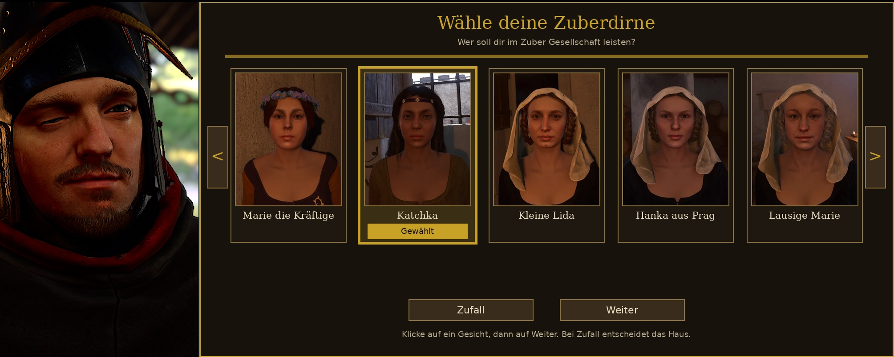
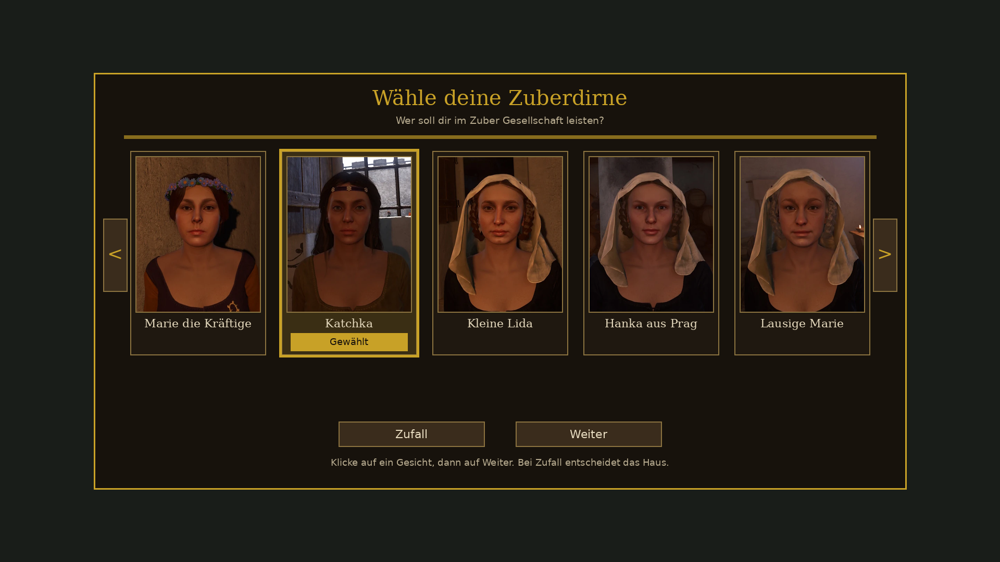

# Bathmaid Choice

**Download:** [bathmaidchoice.zip](https://github.com/Virtunerd/Kingdom-Come-Deliverance-2/releases/download/kcd2/bathmaidchoice.zip)

Tap F at the bathhouse owner to open a window with the faces and names of the bath maids on duty. Pick one and press Continue - the talk with the owner starts, you pay for the love service as usual, and the time wheel and the scene play with the one you picked. Random or talking with E keeps the vanilla choice.

## Screenshots

---

[Steam Workshop](https://steamcommunity.com/sharedfiles/filedetails/?id=3832000566)
