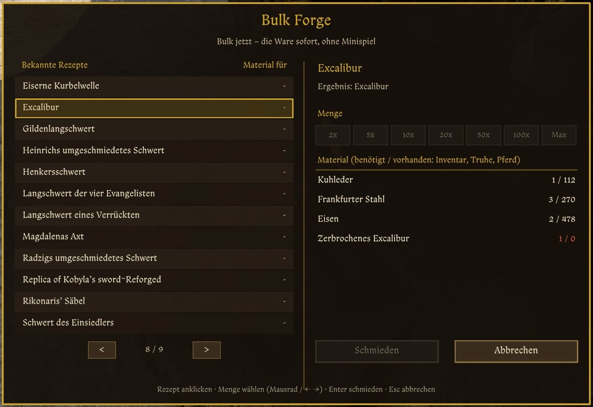
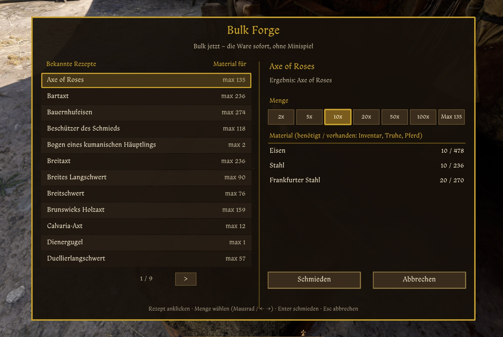
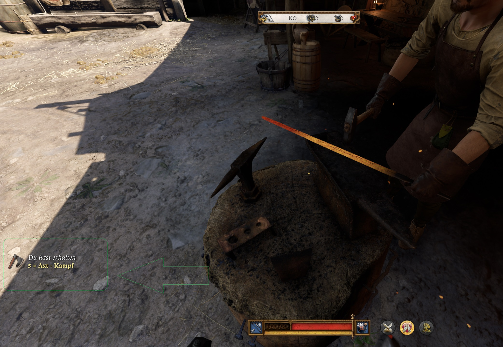
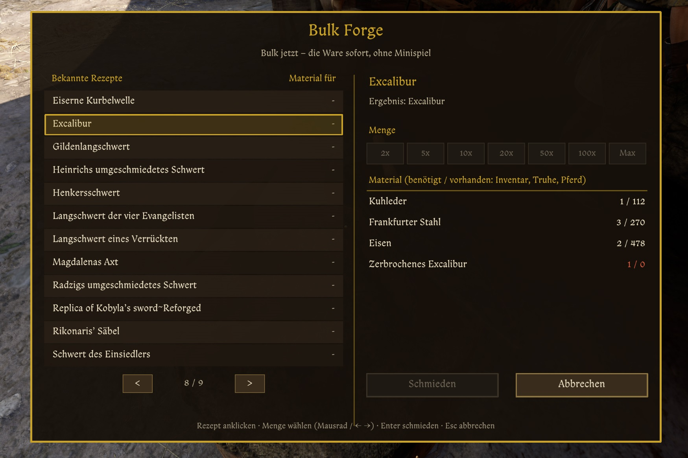

# Bulk Forge

**Download:** [bulkforge.zip](https://github.com/Virtunerd/Kingdom-Come-Deliverance-2/releases/download/kcd2/bulkforge.zip)

Works with "Reforge everything", "Smiths Reach" and "Material Transfer" and all "custom" recipes!

Forge known blacksmith recipes in bulk at the anvil. Tap Q: bulk transfer (pick recipe and amount, goods at once in top tier, no minigame). Hold Q: bulk active once (pick recipe and amount, forge one piece, it gets duplicated). Materials are counted from inventory, master chest and horse; works alongside Smith's Reach and Material Transfer.

## Screenshots

---

[Steam Workshop](https://steamcommunity.com/sharedfiles/filedetails/?id=3831870275)
