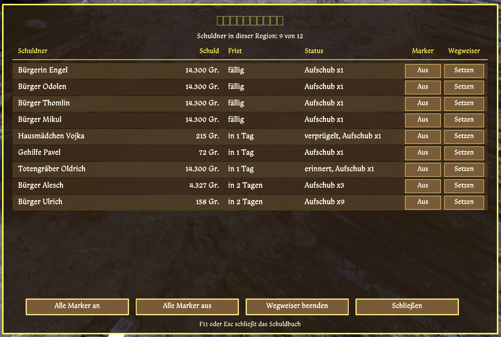

# Moneylender

[Moneylender - Loanshark](https://github.com/Virtunerd/Kingdom-Come-Deliverance-2/releases/download/kcd2/moneylender.zip): Henry becomes a moneylender. Lend 50 to 10,000 groschen to any NPC with interest and a due date. When the time is up, demand payment, threaten (most debtors pay out of fear) or send your thugs if a debtor cannot pay, you decide whether to grant a delay - after a threat it costs him dearly.

The thugs appear out of sight, beat the debtor unconscious with their fists and leave, without involving the crime system. A beaten debtor pays at once when reminded of them.

Every debtor carries a live map marker, the debt book (F11, close with F11 or Esc) lists all debtors, toggles markers and sets a waypoint to them (the waypoint needs MoneylenderNative.asi).

<p align="center"></p>

## Installation

Drag the ASI file from the mod folder to your `Bin\Win64MasterMasterSteamPGO` folder.

## Settings

Settings in mod.cfg.

```
-- Moneylender 1.0.1 - Settings
-- Format: #MoneylenderCfg.Name = Value (keep the leading "#", comments start with --)
-- A missing line or an invalid value falls back to the default.
-- Changes take effect the next time a save is loaded.

#MoneylenderCfg = MoneylenderCfg or {}

-- Loans -------------------------------------------------------------------------
#MoneylenderCfg.MaxDebtors = 12 -- open debts per region at the same time (1-12)
#MoneylenderCfg.Rate1 = 10 -- % interest, "low interest, long term"
#MoneylenderCfg.Days1 = 3 -- days until due
#MoneylenderCfg.Rate2 = 20 -- % interest, "medium"
#MoneylenderCfg.Days2 = 2
#MoneylenderCfg.Rate3 = 30 -- % interest, "high interest, short term"
#MoneylenderCfg.Days3 = 1

-- Collecting --------------------------------------------------------------------
#MoneylenderCfg.PayChance = 35 -- % chance the debtor pays when you demand it
#MoneylenderCfg.ThreatChance = 80 -- % a threatened debtor pays (otherwise he begs for a delay)
#MoneylenderCfg.ThreatDelayRate = 30 -- % added to the debt for a delay granted after a threat
#MoneylenderCfg.BeatBonus = 40 -- % added after a visit from your thugs
#MoneylenderCfg.MaxChance = 95 -- % upper limit
#MoneylenderCfg.DelayDays = 3 -- days granted when the debtor can't pay
#MoneylenderCfg.DelayRate = 10 -- % added to the debt for every delay

-- Thugs -------------------------------------------------------------------------
#MoneylenderCfg.Thugs = 2 -- thugs per visit (1-3)
#MoneylenderCfg.ThugDistance = 30 -- m, where they appear (out of sight)
#MoneylenderCfg.FightChance = 50 -- % chance a male debtor fights back instead of pleading
#MoneylenderCfg.ThreatCalm = 25 -- % less fighting back after a threat
#MoneylenderCfg.KOHealth = 0 -- debtor health (0-100) at which the mod knocks him out (0 = punches decide)
#MoneylenderCfg.ScriptKOHealth = 15 -- a scripted blow below this health knocks out instead of hurting
#MoneylenderCfg.FightTimeout = 120 -- s, knock-out at the latest after this
#MoneylenderCfg.PleadDistance = 12 -- m, a pleading debtor starts begging when the thugs are this close
#MoneylenderCfg.FallbackDelay = 6 -- s without a landed punch before a thug's blow is dealt directly (men)
#MoneylenderCfg.FallbackDelayFemale = 1.5 -- the same for women (they can not enter combat in this game)
#MoneylenderCfg.FallbackDamage = 12 -- health per such blow (0-100, +-25 %)
#MoneylenderCfg.FallbackStamina = 0 -- stamina per such blow (higher values knock him over)
#MoneylenderCfg.FallbackInterval = 1.6 -- s between those blows
#MoneylenderCfg.FallbackReach = 2.6 -- m, a thug must stand this close

-- Test --------------------------------------------------------------------------
#MoneylenderCfg.Debug = 0 -- 1 = log to kcd.log ([Moneylender]), 0 = off
```

---

[Steam Workshop](https://steamcommunity.com/sharedfiles/filedetails/?id=3827729448)
