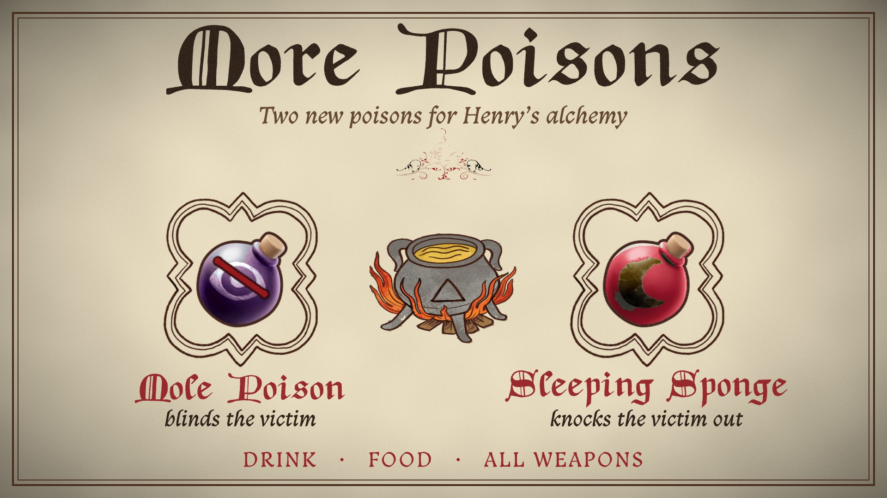
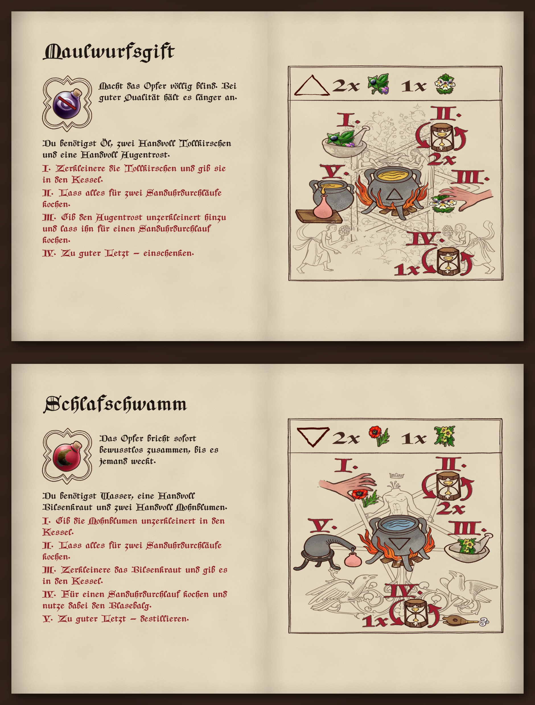

# More Poisons

Two new poisons for Henry's alchemy: **Mole Poison** blinds, **Sleeping Sponge** knocks out. Brew them at the alchemy table, mix them into food or drink, or coat any weapon or your arrows.

---

## Mole Poison

- The victim is **completely blind** for 3, 4, 5 or 7 minutes, depending on quality.
- Same effect and duration whether it is drunk, eaten or delivered by a poisoning hit with any coated weapon or arrow.
- Hearing stays: a blinded guard can still hear you. Made for stealth.
- Ingredients: oil, 2 belladonna, 1 eyebright.

## Sleeping Sponge

- The victim **collapses unconscious at once**, at every quality.
- Works when drunk, eaten or delivered by a poisoning hit with any coated weapon or arrow.
- It is the game's own unconsciousness: the victim stays down until someone wakes them, and can be killed.
- Ingredients: water, 1 henbane, 2 poppy.

## Recipes

Buy both recipes from the **alchemists in Kuttenberg and Troskowitz**. Read them and they appear in Henry's alchemy book, with their own illustrated pages.

**Mole Poison**

1. Grind 2 belladonna and add them to oil.
2. Boil for 2 turns.
3. Add 1 eyebright whole and boil for 1 turn.
4. Pour.

**Sleeping Sponge**

1. Add 2 poppy whole to water.
2. Boil for 2 turns.
3. Grind 1 henbane and add it.
4. Boil for 1 turn using the bellows.
5. Distil.

--- 

## Details

- Four qualities each, up to Henry's.
- Vial of the unknown potion, with inventory icons in their own colour (violet, crimson).
- Weapon charges: Mole Poison 25 / 50 / 75 / 100, Sleeping Sponge 4 / 8 / 12 / 16. Arrows: 10 / 20 / 30 / 40 and 4 / 4 / 4 / 8.
- A hit passes the poison on with the game's normal chance, as with the vanilla poisons.
- Texts in English and German.

## Compatibility

- Adds new table rows, icons and texts. The only vanilla entries touched are the two apothecary shops, which keep their stock and get the two recipes added.
- Works with existing saves (shops show the recipes after their next restock).
- **The Poisoner** can stack Mole Poison and Sleeping Sponge with the vanilla poisons on one weapon.
- **Area Hit Vials** can throw both vials; everyone in the splash radius is affected.

Portions:
wh_cheat_addItem 2cb4b27e-3af2-5f71-9e95-e03879374f44 
wh_cheat_addItem 3d52f08f-ed9a-532e-88ff-c667879a692c

Recipes:
wh_cheat_addItem 2b89769a-a06f-5097-8306-c597c944eeb6
wh_cheat_addItem 540c226c-2dd7-5272-a637-e07727672f79