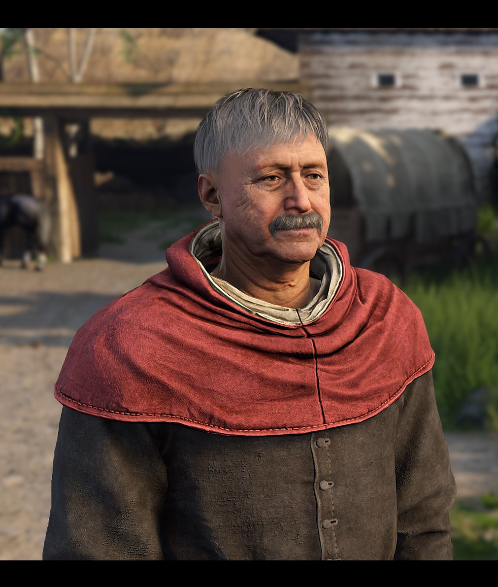
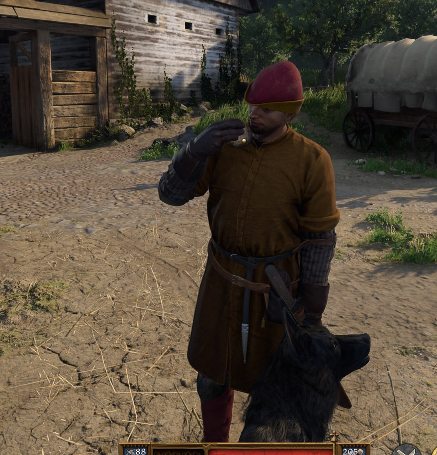
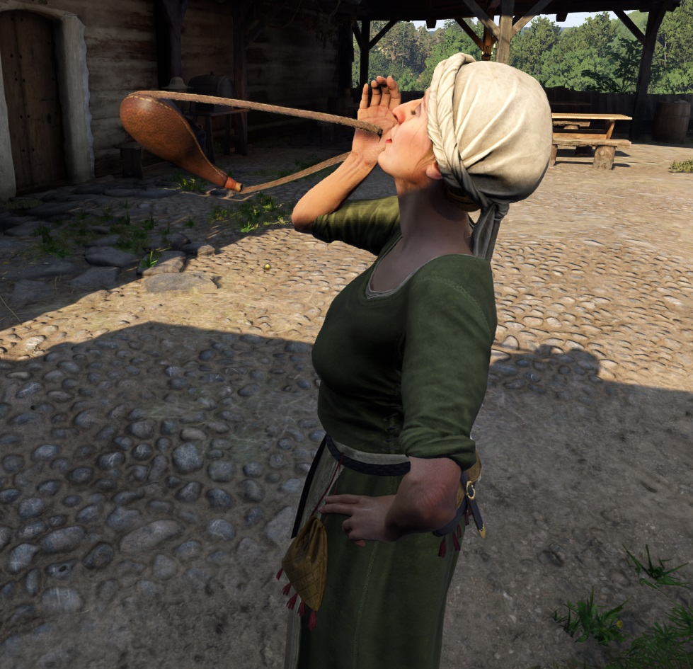
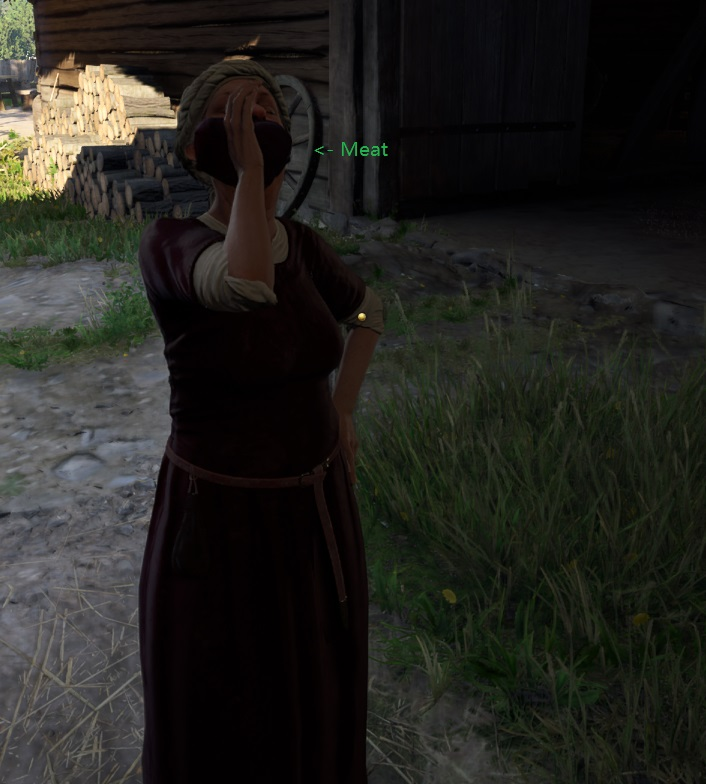
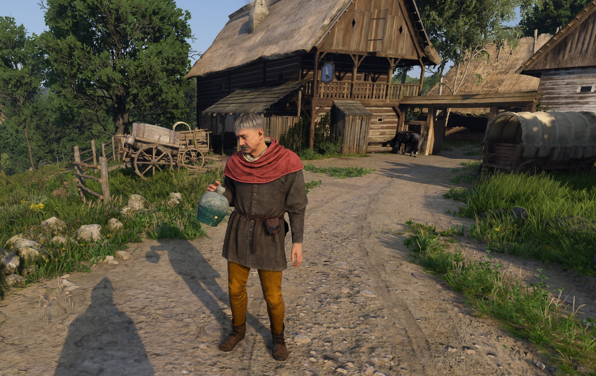
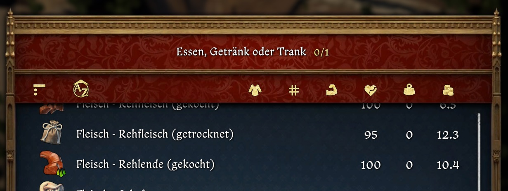
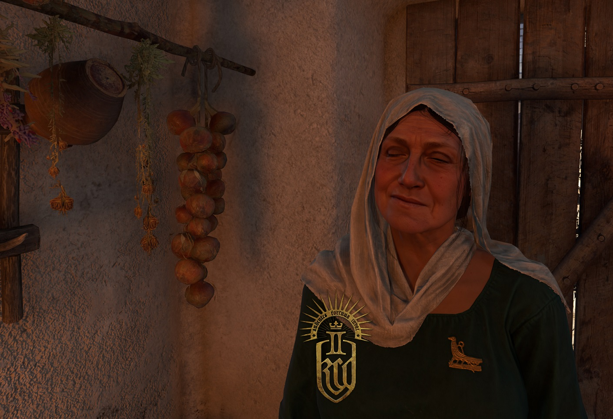

# Offering

**Download:** [offering.zip](https://github.com/Virtunerd/Kingdom-Come-Deliverance-2/releases/download/kcd2/offering.zip)

A funny must-have mod for content creators. Share food, drinks and potions with any open-world NPC. The new dialogue option "Share" opens the vanilla hand-over window, limited to exactly one item of food, drink or potion.

After the conversation the NPC interrupts his routine, takes the item in hand and consumes it through the game's own item use, so potions, alcohol and poison take effect.

KCD2 has few standing eat and drink animations, so NPCs stand up first and women use a drinking motion for food as well.

Replaces AI/npc/basic/switch/switch.xml; the file already contains the hooks of Silvertongue and Moneylender, so Offering must load after them.

## Screenshots

---

[Steam Workshop](https://steamcommunity.com/sharedfiles/filedetails/?id=3832331667)
