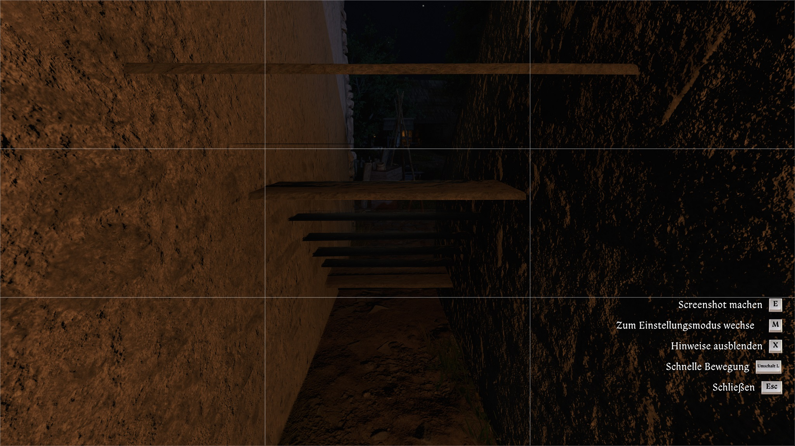
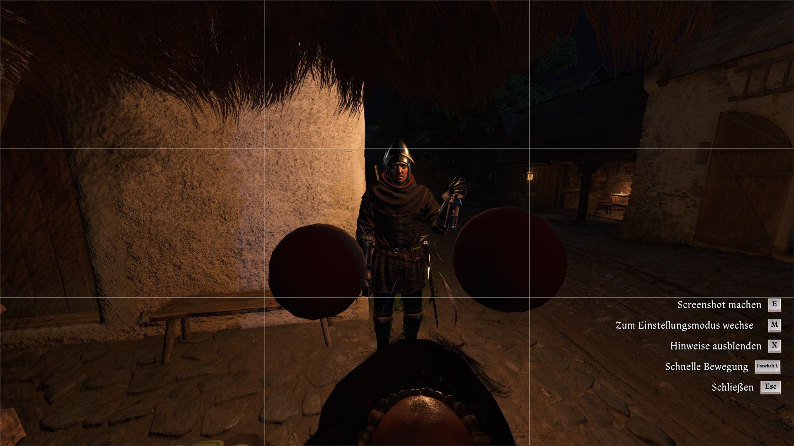
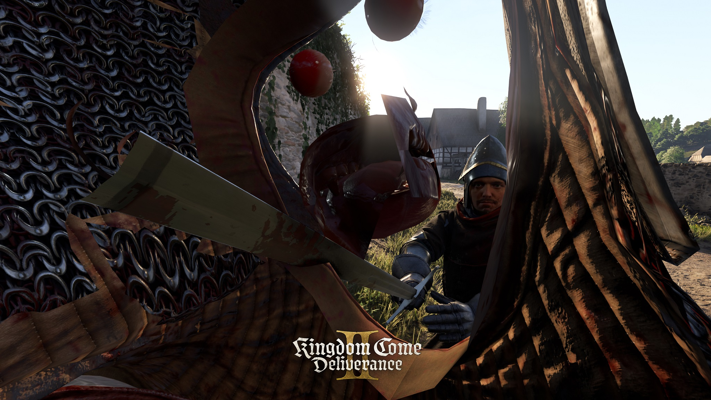
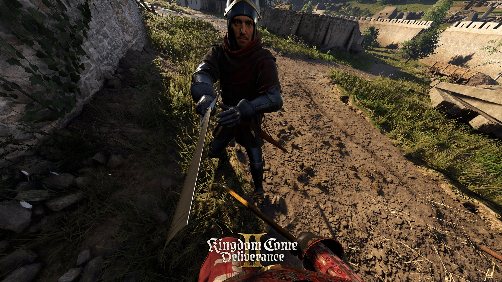
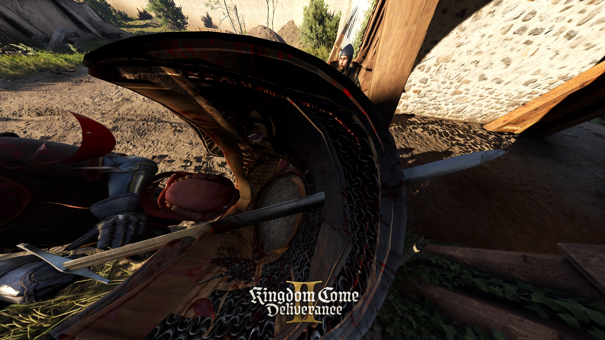
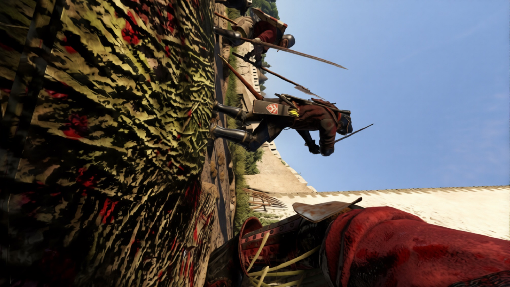

# Photomode Noclip

**Download:** [photonoclip.zip](https://github.com/Virtunerd/Kingdom-Come-Deliverance-2/releases/download/kcd2/photonoclip.zip)

Photomode: the camera no longer collides with objects and flies through walls, trees, NPCs and everything else. The distance limit to Henry stays vanilla.

Requires `PhotoNoClip.asi` in `Bin\Win64MasterMasterSteamPGO` (ASI loader).

## Screenshots

---

[Steam Workshop](https://steamcommunity.com/sharedfiles/filedetails/?id=3832488264)
