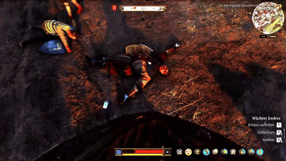

# Slicer

[Slicer](https://github.com/Virtunerd/Kingdom-Come-Deliverance-2/releases/download/kcd2/slicer.zip/): is a real serial killer mod. You can slaughter/butcher killed NPCs to get their meat. Mouse movement changes the NPC model to bones, and bones are left on the ground. If you loot the bones, they disappear! This way, NPCs won't know that there was a corpse. You can cook the meat, sell it, or give Mutt some food.

