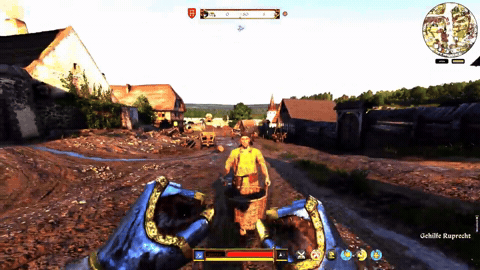

# Spartacus

[Spartacus](https://github.com/Virtunerd/Kingdom-Come-Deliverance-2/releases/download/kcd2/Spartacus_1.0.1.zip):
A free kick (block + attack, unarmed, out of combat) sends people flying as a ragdoll. Afterwards they hold their stomach (injured torso) and are left with little health.

Optional: Spartacus_ASI detects the hit by its sound.

v1.0.1

---

[Steam Workshop](https://steamcommunity.com/sharedfiles/filedetails/?id=3827612720)
