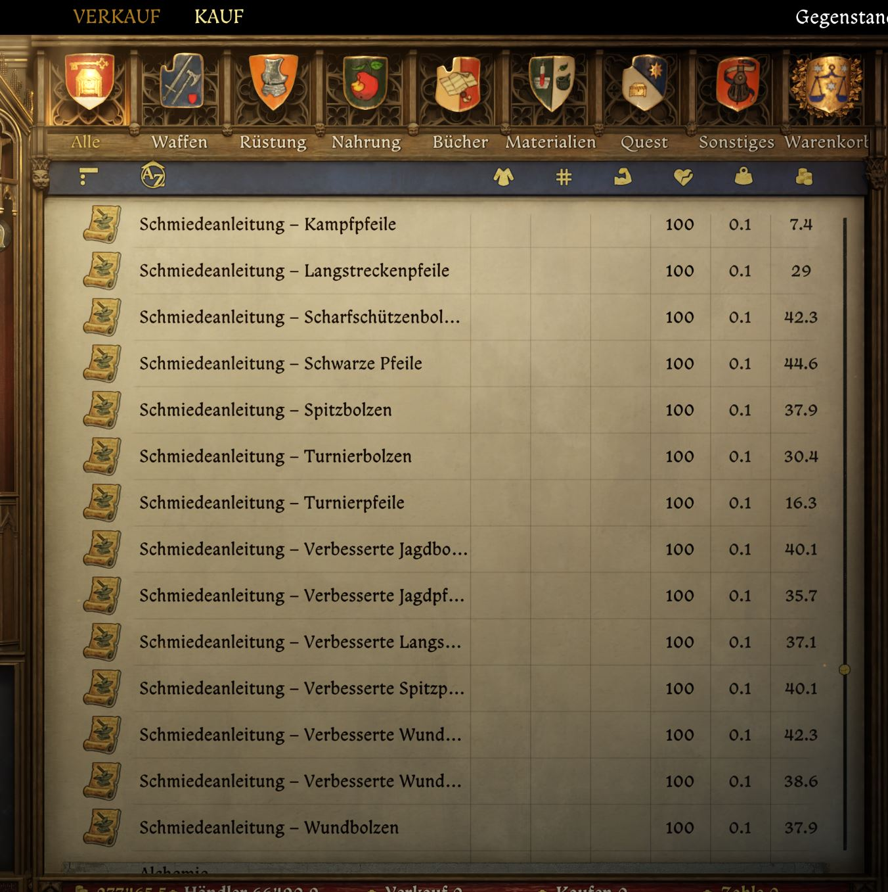
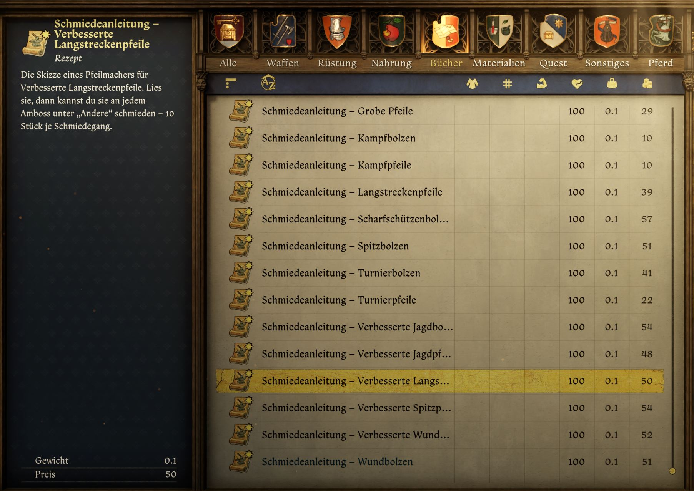

# Survivalist

**Download:** [survivalist.zip](https://github.com/Virtunerd/Kingdom-Come-Deliverance-2/releases/download/kcd2/survivalist.zip)

<p align="center"></p>

Stop buying ammo and forge every arrow and bolt you need yourself.

Survivalist adds blacksmith sketches for **every vanilla arrow and crossbow bolt**, the **Black arrow** included. Buy a sketch, read it and forge the ammo at any anvil. Each forging gives you **10 arrows or bolts**.

## Features

- **26 new recipes**: 13 arrows and 13 bolts, all listed in the vanilla smithing screen under **Other**.
- **10 pieces per forging**: the anvil makes a bundle that turns into 10 arrows or bolts right away.
- **Cheap sketches**, 10 to 60 groschen. The stronger the ammo, the pricier the sketch.
- **Sold by many traders**: blacksmiths, weaponsmiths, gunsmiths, shootmasters and huntsmen (32 shops, 10 of them in Kuttenberg).
- **Materials every blacksmith sells**: scrap metal, iron, steel, Frankfurt steel, Toledo steel, charcoal and fastening material.
- Arrow and bolt blanks are forged with the sword blank on the anvil.
- Not included: quest ammo and the magic arrow.

## Ammo from other mods – no sketch needed
If another mod adds arrows or bolts, two extra recipes show up on their own: **Modded arrows ×10** and **Modded bolts ×10** (steel + fastening material).

- With only one modded kind installed, that kind is forged.
- With several kinds, carry one as a pattern. The kind you carry most of gets copied.

## Recipes

| Arrows (×10) | Materials | Sketch |
|---|---|---|
| Battle arrows | Scrap metal, fastening material | 10 gr |
| Tournament arrows | Scrap metal, fastening material | 22 gr |
| Crude arrows | Scrap metal, fastening material | 29 gr |
| Ordinary arrows | Iron, fastening material | 33 gr |
| Long-range arrows | Iron, 2 fastening material | 39 gr |
| Hunting arrows | Steel, fastening material | 41 gr |
| Wounding arrows | 2 iron, fastening material | 43 gr |
| Piercing arrows | Steel, iron, fastening material | 47 gr |
| Improved hunting arrows | 2 steel, fastening material | 48 gr |
| Improved long-range arrows | Steel, iron, 2 fastening material | 50 gr |
| Improved wounding arrows | Frankfurt steel, fastening material | 52 gr |
| Improved piercing arrows | Frankfurt steel, steel, fastening material | 54 gr |
| Black arrows | Toledo steel, 2 charcoal, fastening material | 60 gr |

| Bolts (×10) | Materials | Sketch |
|---|---|---|
| Battle bolts | Scrap metal, fastening material | 10 gr |
| Crude bolts | Scrap metal, fastening material | 29 gr |
| Common bolts | Iron, fastening material | 35 gr |
| Tournament bolts | 2 scrap metal, fastening material | 41 gr |
| Hunting bolts | Iron, scrap metal, fastening material | 41 gr |
| Marksman's bolts | Steel, fastening material | 48 gr |
| Wounding bolts | 2 iron, fastening material | 51 gr |
| Piercing bolts | Steel, iron, fastening material | 51 gr |
| Improved hunting bolts | 2 steel, fastening material | 54 gr |
| Sharpshooter's bolts | Steel, iron, 2 fastening material | 57 gr |
| Improved wounding bolts | Frankfurt steel, fastening material | 57 gr |
| Improved piercing bolts | Frankfurt steel, steel, fastening material | 59 gr |
| Fine bolts | Toledo steel, fastening material | 60 gr |

## Where to buy the sketches in Kuttenberg

- Blacksmiths on Kupecká (corner and crossroad)
- Weaponsmiths on Radnická street, Radnická square, Kupecká and Leflířská
- The Kuttenberg shootmaster and Kafka (DLC)
- The Kuttenberg gunsmith
- The horse blacksmith at the horse market

Outside Kuttenberg the sketches are sold by every blacksmith, shootmaster and huntsman.

## Compatibility

- Safe for existing saves. The sketches show up at the traders right away.
- Mods that change what shops stock or how much money they have still work.
- Mods that change the shop entries of the same traders (for example price mods) can conflict. Load Survivalist after them.
- Works with Bulk Forge, Smith's Reach and Material Transfer.
- English and German.

## Uninstalling
Your forged arrows and bolts stay. Sketches you have learned and unread sketches lose their function.

----------------------------------------

## Console
You can also add the sketches with the console command:

```
wh_cheat_addItem <item id>
```

Arrows:

```
wh_cheat_addItem 469c60ca-c3fc-5692-bdc4-b83d94de5b11
wh_cheat_addItem 2562853c-33ae-53c6-8073-b19fb61a0a58
wh_cheat_addItem 3b988191-25cd-5e50-80a0-0a25b0a2dc9c
wh_cheat_addItem 37e37e9d-576b-5731-8cea-52ddc994bbcd
wh_cheat_addItem fc28ca00-d994-5068-b31a-d40a7e73b262
wh_cheat_addItem df5378c3-5a25-5fe3-a6e6-38a2ef1c31da
wh_cheat_addItem 10851abe-0cfd-55f1-bfbd-c4bfa9fac620
wh_cheat_addItem 544efbbf-7a47-59b1-ac07-238284322f04
wh_cheat_addItem e802dcc2-9efa-5245-9389-db3b10361a7e
wh_cheat_addItem 0a79fc84-8d1d-57f3-913c-2bf7b29cfd3a
wh_cheat_addItem d77c3768-5f52-51a4-be27-f647233c81bb
wh_cheat_addItem 93a9bc35-ad1f-53a8-880f-57d082d7857e
wh_cheat_addItem 8358a295-204d-5525-aa30-df9f9fa0ed05
```

Bolts:

```
wh_cheat_addItem b4ee3747-51f4-5833-a512-7d243240ad50
wh_cheat_addItem 2a5ab5f0-4646-57cf-9172-523b1f5e488d
wh_cheat_addItem d836cefd-a743-59ec-8873-426cc63b47e1
wh_cheat_addItem d8d89177-ac34-5009-a216-c65a21642d09
wh_cheat_addItem 818026f3-f150-5653-a88a-531a50af1cf8
wh_cheat_addItem 68842887-9426-50e4-afc3-e311ae315d97
wh_cheat_addItem 3fa1168a-fbf0-5b23-ad15-04b5880935c4
wh_cheat_addItem 905553f6-4193-51af-a841-ff30bdf233ca
wh_cheat_addItem 1670282e-9cb7-57cb-a832-5405a7c4a0a6
wh_cheat_addItem 30b23d19-f54d-59e8-b3b2-86ec39614673
wh_cheat_addItem 17d47256-9eb3-50e4-8cd2-20bbf76292b0
wh_cheat_addItem f51a810d-1222-5b12-ae0a-0871fca3e375
wh_cheat_addItem d4b11459-7414-5025-b1ac-2dd22a975c54
```

## Screenshots

<p align="center"></p>

---

[Steam Workshop](https://steamcommunity.com/sharedfiles/filedetails/?id=3832979634)
