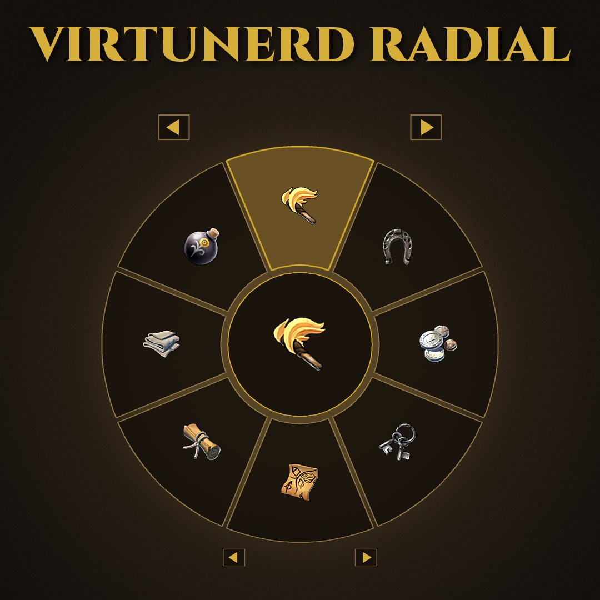

# Virtunerd Radial

**Download:** [VirtunerdRadial.zip](https://github.com/Virtunerd/Kingdom-Come-Deliverance-2/releases/download/kcd2/VirtunerdRadial.zip)

<p align="center"></p>

# One radial menu for all your mods. Hold Ctrl, point, release.

Virtunerd Radial is a ring menu that other mods plug into. Each mod adds its own tab, and the arrows at the top of the ring switch between them.

**Important:** on its own this mod shows nothing. The ring only opens once at least one mod adds a tab, for example **Area Hit Vials**.

## How to use

- **Hold left Ctrl**: the ring opens in the middle of the screen. Henry and the camera stand still while it is open.
- **Point with the mouse** at one of the 8 fields. It lights up gold. A click selects as well.
- **Release Ctrl**: the ring closes and the selected entry is used.
- **Arrows at the top**: switch between the mods that added a tab.
- **Mouse wheel** or the small arrows below the ring: turn pages when a tab has more than 8 entries.

Opening and closing the ring without pointing at an entry does nothing. The ring also closes without action when you press Ctrl again, press E, open a menu (inventory, map, pause) or load a save. It does not open while riding, sitting or in a dialog. The right mouse button does nothing in the ring.

The ring remembers the last tab you used. Texts follow the game language (English or German).

## Area Hit Vials
Area Hit Vials has the same ring built in. Neither mod needs the other:

| Installed | Who draws the ring |
|---|---|
| Only Area Hit Vials | Area Hit Vials (built-in ring) |
| Only Virtunerd Radial | Virtunerd Radial |
| Both | Virtunerd Radial, Area Hit Vials stays silent |

Either way you get exactly one ring with all tabs. Load order does not matter.

## Compatibility

- Replaces no game files. Everything uses its own file names.
- Uses left Ctrl. In vanilla, Ctrl only slows down the horse, and the ring does not open while riding.
- No dependencies, any load order.
- Mouse only. Controller is untested.

## For modders: add your own tab
Put this at the top level of your mod's Lua (`Scripts/Mods/<modid>.lua`). No dependency and no copy of the ring needed. If neither Virtunerd Radial nor Area Hit Vials is installed, the table is simply never read.

```
VirtunerdRadial = VirtunerdRadial or {}
VirtunerdRadial.Tabs = VirtunerdRadial.Tabs or {}
VirtunerdRadial.Tabs["mymod"] = {
    title = { english = "My Mod", german = "Meine Mod" },
    order = 50,
    entries = function()
        return {
            { id = "rest", label = "Rest", icon = "torch", info = "Sit down by the fire",
              run = function(entry) MyMod.Rest() end },
        }
    end,
}
```

**Tab fields:** title, order (smaller = further left, Area Hit Vials = 0, default 100), **entries** (required), hint, empty, current.
**Entry fields:** **label** (required), id, icon, name, info, extra (green line), badge (small green text, e.g. a count), run.

- **run(entry)** is called only after Ctrl is released and the controls are back on, and only if the player pointed at, clicked or picked an entry during this opening. You can open your own window inside run.
- **entries()** runs on open, on tab switch and every 0.25 s while the ring is open. Keep it cheap: no entity searches, no file access.
- Errors in entries(), current() and run() are caught. A broken tab shows up empty, all other tabs keep working.
- Every text field takes a string or { english = "...", german = "..." }. Keep strings ASCII and write umlauts as escapes ("w\195\164hlen").
- The tab id "vials" is taken by Area Hit Vials.

### Icons
Only the built-in game icons below are available, custom images are not possible. An unknown id shows no icon. Without an icon the label is shown large in the field.

```
General: horseshoe basicsaddle01_m01 money valuables_bag key_general keyring map_book torch letter_simple lorebook_adorned_01 player_lockpick bandage_classic repairkit_weaponsmall soap bow_a arrow_crude herb_chamomile

Potions and poisons: bane_poison hooch mead paralysis_poison sleeping_poison potion_aesop potion_antidote potion_antiiflammatorypotion potion_antiplaguepotion potion_aquavitalis potion_artemisia potion_bard potion_bowmans_brew potion_camomile_decoction potion_embrocation potion_fevertonic potion_hair_o_dog potion_insomnia potion_marigold potion_nighthawk potion_padfoot potion_painkiller potion_stamina
```

---

[Steam Workshop](https://steamcommunity.com/sharedfiles/filedetails/?id=3835245525)
