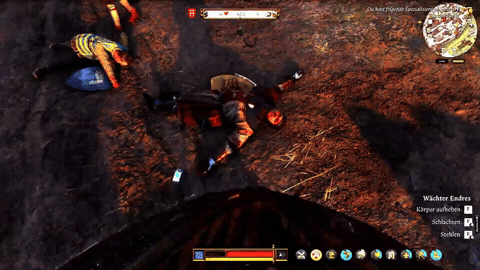
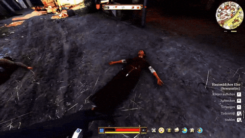

#### Author:
- [Virtunerd - 160k+ downloads, 170+ mods](https://virtunerd.github.io)

For social-proof you can check my banned profile on nexusmods. All mods except my reaper are at the steam workshop as well.  
- [@Nexusmods: My banned profile](https://www.nexusmods.com/profile/Virtunerd)


<p align="left"></p> 

[Check the workshop](https://steamcommunity.com/profiles/76561198183169443/myworkshopfiles/?appid=1771300)


--- 

### Mods - click to download

Latest:

[Simple VRM - Radial Menu](https://github.com/Virtunerd/Kingdom-Come-Deliverance-2/releases/download/kcd2/VirtunerdRadial.zip/)

[Steamworkshop description here](https://steamcommunity.com/sharedfiles/filedetails/?id=3835245525)

--- 

[Area Hit Vials - Throwable Portion Schnaps Poison - Radial Menu Included](https://github.com/Virtunerd/Kingdom-Come-Deliverance-2/releases/download/kcd2/AreaHitVials.zip/)

--- 

[Framed - Guards Arrest NPCs For You - Dungeon](https://github.com/Virtunerd/Kingdom-Come-Deliverance-2/releases/download/kcd2/Framed.zip/)

--- 

[Shadowmaker - Shoot-Throw holded-static Flames](https://github.com/Virtunerd/Kingdom-Come-Deliverance-2/releases/download/kcd2/Shadowmaker.zip/)

--- 

[Immersive Timeskip - The World Moves On](https://github.com/Virtunerd/Kingdom-Come-Deliverance-2/releases/download/kcd2/ImmersiveTimeskip.zip/)

--- 

[Shouts - Battlecry Stops Witnesses - Turn Enemies Into Allies](https://github.com/Virtunerd/Kingdom-Come-Deliverance-2/releases/download/kcd2/Shouts.zip/)

--- 

[Shackles - Take Hostages](https://github.com/Virtunerd/Kingdom-Come-Deliverance-2/releases/download/kcd2/shackles.zip/)

--- 

[Carrying Body - Throw and Weapondraw](https://github.com/Virtunerd/Kingdom-Come-Deliverance-2/releases/download/kcd2/Carrying_Body_Throw_Weapondraw.zip/)

--- 

[Door Jammer - No One gets in or out](https://github.com/Virtunerd/Kingdom-Come-Deliverance-2/releases/download/kcd2/doorjammer.zip/)

--- 

[Faces - Change one piece of armor out-of-sight to be undetected again like in Hitmen47](https://github.com/Virtunerd/Kingdom-Come-Deliverance-2/releases/download/kcd2/Faces.zip/)

--- 

[Repair Kit Select All - QOL](https://github.com/Virtunerd/Kingdom-Come-Deliverance-2/releases/download/kcd2/RepairKitSelectAll.zip/)

--- 

[Survivalist - Craft Arrows And Bolts](https://github.com/Virtunerd/Kingdom-Come-Deliverance-2/releases/download/kcd2/survivalist.zip/)

--- 

[The Poisoner - Stack Effects](https://github.com/Virtunerd/Kingdom-Come-Deliverance-2/releases/download/kcd2/ThePoisoner.zip/)

--- 

[Iron Liver - No Skill - Cap - No Negative Phase](https://github.com/Virtunerd/Kingdom-Come-Deliverance-2/releases/download/kcd2/IronLiver.zip/)

--- 

[Photomode: No Collision - POV - Spy - the camera no longer collides with objects](https://github.com/Virtunerd/Kingdom-Come-Deliverance-2/releases/download/kcd2/photonoclip.zip/)

--- 

[Athleticus - Doublejump - Grabs edges](https://github.com/Virtunerd/Kingdom-Come-Deliverance-2/releases/download/kcd2/athleticus.zip/)

--- 

[Offering - Share food drinks portion and watch them consume it](https://github.com/Virtunerd/Kingdom-Come-Deliverance-2/releases/download/kcd2/offering.zip/)

--- 

[Horse Deed - Stable Pool](https://github.com/Virtunerd/Kingdom-Come-Deliverance-2/releases/download/kcd2/horsedeed_1.0.0.zip/)

--- 

[Bath Maid Choice - Your maid selector](https://github.com/Virtunerd/Kingdom-Come-Deliverance-2/releases/download/kcd2/bathmaidchoice.zip/)

--- 

[Bulk Forge - Transfer](https://github.com/Virtunerd/Kingdom-Come-Deliverance-2/releases/download/kcd2/bulkforge.zip/)

--- 

[Keep My Weapon - ASI](https://github.com/Virtunerd/Kingdom-Come-Deliverance-2/releases/download/kcd2/keepmyweapon.zip/)

--- 

[Herbharvest ASI - Radius for ALL herbs](https://github.com/Virtunerd/Kingdom-Come-Deliverance-2/releases/download/kcd2/herbharvest.zip/)

--- 

- [Argus](https://github.com/Virtunerd/Kingdom-Come-Deliverance-2/releases/download/kcd2/argus.zip/): is a simple mod, which implements a dot-icon in blue/orange on the right side of the compass and indicates if Henry is undetected/undercover, like in Skyrim.
--- 

- [Bone Broker - Medicus](https://github.com/Virtunerd/Kingdom-Come-Deliverance-2/releases/download/kcd2/bonebroker.zip/): Kane Walshire, a shady Englishman and former assistant to a medicus, waits outside Kuttenberg's eastern gate and buys human bones and skulls for groschen.  Side quest "Find the Mysterious Merchant" starts on its own in the Kuttenberg region (innkeepers also share the rumour).  Once you have met him, sell all your bones through his dialogue ([Sell all bones]): 75 groschen per bone, 200 per thighbone, 400 per skull. A merchant icon marks his spot on the map. Accepts the bone parts from the Slicer mod
<p align="center"></p>
<p align="center"></p>

- [House of Bardi - Bank Account](https://github.com/Virtunerd/Kingdom-Come-Deliverance-2/releases/download/kcd2/houseofbardi.zip/): Florentine bankers who broke with the Church to serve the people. Lorenzo Bardi stands outside the Italian Court in Kuttenberg, his nephew Niccolo in Troskowitz.  They buy gold, silver, chalices, crosses and jewellery, and keep your groschen. Open an account, get a bank letter, deposit and withdraw at either table. Both bankers are marked on the map. Settings in mod.cfg.
<p align="center"></p>
<p align="center"></p>

--- 

<p align="center"></p>
<p align="center"></p>


- [Highwayman](https://github.com/Virtunerd/Kingdom-Come-Deliverance-2/releases/download/kcd2/highwayman.zip/): Rob any NPC through dialogue. Your charisma and other stats matter, too. An inventory window opens up, and items are not stolen afterwards. The victim will not remember your crime. 
---

- [Hush Money](https://github.com/Virtunerd/Kingdom-Come-Deliverance-2/releases/download/kcd2/hushmoney.zip/):
The Coin of Silence - a five-part quest line. Matej Havel in the Black Horse tavern in Kuttenberg hires Henry for five contract killings. Dialogue choices, sparing targets, three endings.
---  

- [Incognito](https://github.com/Virtunerd/Kingdom-Come-Deliverance-2/releases/download/kcd2/incognito.zip/): is a Red Dead Redemption "bandana"-like mod that gives Henry access to crime actions when he puts his helmet visor down. No NPC recognizes Henry as long as the visor is down.
--- 

- [Instigator](https://github.com/Virtunerd/Kingdom-Come-Deliverance-2/releases/download/kcd2/instigator.zip/): Through dialogue, you can say something like "I got something for you" to send any NPC into a fight with another NPC. You can select whether the fight is a fistfight or an armed fight to the death.
--- 

- [Landlord](https://github.com/Virtunerd/Kingdom-Come-Deliverance-2/releases/download/kcd2/landlord.zip/): Over 140 income possibilities (passive money every midnight), dialogues, owner items for your inventory, and more. All objects give you about 21,000 groschen every midnight.
--- 

- [Moneylender - Loanshark](https://github.com/Virtunerd/Kingdom-Come-Deliverance-2/releases/download/kcd2/moneylender.zip/): Henry becomes a moneylender. Lend 50 to 10,000 groschen to any NPC with interest and a due date. When the time is up, demand payment, threaten (most debtors pay out of fear) or send your thugs if a debtor cannot pay, you decide whether to grant a delay - after a threat it costs him dearly.  The thugs appear out of sight, beat the debtor unconscious with their fists and leave, without involving the crime system. A beaten debtor pays at once when reminded of them.  Every debtor carries a live map marker, the debt book (F11, close with F11 or Esc) lists all debtors, toggles markers and sets a waypoint to them (the waypoint needs MoneylenderNative.asi). Settings in mod.cfg.
<p align="center"></p>

- [Last Known Player Position](https://github.com/Virtunerd/Kingdom-Come-Deliverance-2/releases/download/kcd2/lastknownposition.zip/): Vanilla gives any searching AI (enemies, guards, etc.) a blind anchor around Henry of 0.5 m, but this mod cuts it off. Area searching is still active. It also gives Mutt, your dog, the ability to perform an undercover attack (no crime for the player) and attack unconscious NPCs, such as sleeping ones, from up to 40 meters away.
--- 

- [Lockbreaker](https://github.com/Virtunerd/Kingdom-Come-Deliverance-2/releases/download/kcd2/lockbreaker.zip/): Stand in front of a door or a chest and kick it. This will break the lock, allowing you to open the door or chest. The “Pick Lock” HUD indicator must be displayed.
--- 

- [Slicer](https://github.com/Virtunerd/Kingdom-Come-Deliverance-2/releases/download/kcd2/slicer.zip/): is a real serial killer mod. You can slaughter/butcher killed NPCs to get their meat. Mouse movement changes the NPC model to bones, and bones are left on the ground. If you loot the bones, they disappear! This way, NPCs won't know that there was a corpse. You can cook the meat, sell it, or give Mutt some food.

<p align="center"></p>

--- 

- [Silent takedown](https://github.com/Virtunerd/Kingdom-Come-Deliverance-2/releases/download/kcd2/silenttakedown.zip/):
Stealth-kill and stealth-kockout will be silent. No NPC will hear your work. It works in any situation - like two NPCs are walking and you stealth kill the NPC behind the first one. Or NPCs sleep in a tent next to each other etc.. 
--- 

- [Spartacus](https://github.com/Virtunerd/Kingdom-Come-Deliverance-2/releases/download/kcd2/spartacus_1.0.1.zip/):
A free kick (block + attack, unarmed, out of combat) sends people flying as a ragdoll. Afterwards they hold their stomach (injured torso) and are left with little health. Optional: Spartacus_ASI detects the hit by its sound.

<p align="center"></p>

--- 

- [Silvertongue - Heartbroken to death](https://github.com/Virtunerd/Kingdom-Come-Deliverance-2/releases/download/kcd2/Silvertongue.zip/): Manipulate any open-world NPC with a dramatic lie in Henry's own voice. The NPC withdraws to a bench, mourns with tears and grief-stricken words, then collapses and dies; important characters only pass out. Requires SoundFramework.
--- 

- [Wake Up](https://github.com/Virtunerd/Kingdom-Come-Deliverance-2/releases/download/kcd2/wakeup.zip/): Keybind "H" wakes an unconscious human NPC within reach. (Wakes up ko´d NPCs) Hooks the interaction list at runtime instead of replacing a vanilla script, so it works alongside other mods.
--- 

- [Wenzels Power](https://github.com/Virtunerd/Kingdom-Come-Deliverance-2/releases/download/kcd2/wenzels_power.zip/): Sets all visible perks (including modded ones) at your perk trees to active.
--- 

- [Wholesale](https://github.com/Virtunerd/Kingdom-Come-Deliverance-2/releases/download/kcd2/wholesale.zip/): Skip the quantity slider: when trading, hold E to add an item’s whole stack to the basket, or hold V to add every item in that category. At a chest or stash, hold V to move a whole category to the other side in one go, with no amount window. Info: Asi files must manually dropped in "Win64MasterMasterSteamPGO" next to the KCD2.exe. Mod as usual in mods.
--- 

### BANNED MOD: only here 

- Trigger warning! [Reaper accurate shocking sfx and no time-wheel interruption - soundframework required](https://github.com/Virtunerd/Kingdom-Come-Deliverance-2/releases/download/kcd2/reaper_1.0.1_CUSTOM_SOUNDFX.zip/):
Have sex with KO'd women. There is a timeskip and audio, a buff for Henry, but also an injured torso buff for the victim plus all armor/clothing are unequipped afterwards. (no loot for henry)

<p align="center"></p>


--- 
## Install

```bash
 path-kcd2.. \Mods
 ASI.. Bin\Win64MasterMasterSteamPGO
```
    
## Permission

You have my permission to use them in KCD2 with any mod loader or by installing them manually. I created all these mods. 

[](https://choosealicense.com/licenses/mit/)

